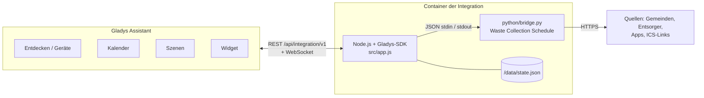
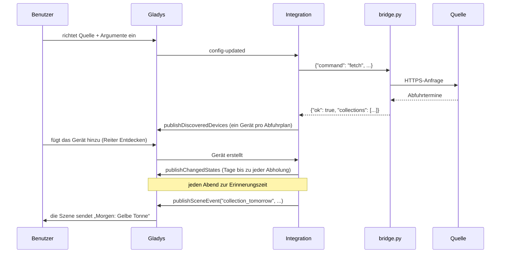

# Waste Collection Schedule für Gladys Assistant

[English](README.md) | [Français](README.fr.md) | **Deutsch** | [Español](README.es.md)

[](LICENSE)
[](https://github.com/William-De71/gladys-waste-collection-schedule/releases)
[](https://github.com/William-De71/gladys-waste-collection-schedule/actions/workflows/release.yml)
[](https://gladysassistant.com)


Die Abfuhrtermine Ihrer Adresse in Gladys Assistant, aus den fast 1.000 Quellen von [Waste Collection Schedule](https://github.com/mampfes/hacs_waste_collection_schedule) (Gemeinden, Entsorger, Apps und ICS-Kalenderlinks aus rund dreißig Ländern). Geräte, eine Erinnerung am Vorabend, ein Dashboard-Widget und in der Kalender-Variante die Abholungen im Gladys-Kalender.

## Funktionen

- **Fast 1.000 Quellen**: die Bibliothek Waste Collection Schedule selbst (MIT), im Image enthalten und fest versioniert, wöchentlich per Workflow aktualisiert. Jeder ICS-Kalenderlink funktioniert ebenfalls.
- **Bis zu drei Abfuhrpläne** (ein Ferienhaus oder eine zweite Quelle für dieselbe Adresse).
- **Geräte**: Tage bis zur nächsten Abholung, ihre Abfallarten und die Tage bis zur nächsten Abholung jeder Abfallart.
- **Kalender-Variante** ([Waste Collection Calendar](https://github.com/William-De71/gladys-waste-collection-calendar), dasselbe Image): ein Kalender pro Abfuhrplan für jeden Benutzer, der sie aktiviert.
- **Dashboard-Widget** „Nächste Abholungen“, mit einer Tonne in der passenden Farbe für jeden Abholtag.
- **Szenen-Auslöser**: Abholung morgen (Erinnerung am Abend), Abfallart wird morgen abgeholt, Abholung heute (Erinnerung am Morgen), Aktualisierung fehlgeschlagen.
- **Szenen-Aktionen**: nächste Abholung abrufen (wahlweise einer Abfallart), Abfuhrtermine aktualisieren.
- **Schaltflächen in der Konfiguration**: Quelle nach Ort, Entsorger oder Land suchen; Abfuhrpläne testen.
- **Abfallarten umbenennen und ausblenden**, Aktualisierungsintervall wählen, Texte auf Englisch, Französisch, Deutsch und Spanisch.

## Funktionsweise




Ein Image läuft als zwei Integrationen des Stores. Bei jeder Verbindung fragt der Container Gladys nach seinen Kalenderkonten: Eine Kalender-Integration erhält sie, eine Geräte-Integration erhält ein 403, und der Container wählt seinen Modus. Ein Takt im Minutenabstand fragt die fälligen Abfuhrpläne ab (je ein kurzer Python-Prozess, einer nach dem anderen), veröffentlicht die neuen Werte um Mitternacht und löst die Erinnerungen aus.



## Geräte und Funktionen

| Funktion                                 | Kategorie / Typ      | Einheit | Bereich  | Wert                                                                 |
| ---------------------------------------- | -------------------- | ------- | -------- | -------------------------------------------------------------------- |
| Nächste Abholung (Tage)                  | `duration / integer` | Tage    | -1 – 400 | Tage bis zur nächsten Abholung: 0 heute, 1 morgen, -1 nichts geplant |
| Nächste Abholung                         | `text / text`        |         |          | die Abfallarten dieser Abholung                                      |
| _&lt;Abfallart&gt;_ (Tage), eine pro Art | `duration / integer` | Tage    | -1 – 400 | Tage bis zur nächsten Abholung dieser Art                            |

Ein Gerät pro Abfuhrplan, externe ID `ext:<selector>:schedule:<1|2|3>`. Gladys fragt es nicht ab (`should_poll: false`): Die Integration veröffentlicht die Werte nach jeder Abfrage und um Mitternacht. Die Namen der Abfallarten sind die der Quelle; eine Art außerhalb der Saison behält ihre Funktion (Wert -1).

## Transport

**Nur Cloud** (`"transports": ["cloud"]`): Jede Quelle ist eine Website oder eine API im Internet, die standardmäßig alle 12 Stunden von Ihrem Gladys aus abgefragt wird. Der Katalog zeigt das Cloud-Abzeichen; es gibt keine Schaltfläche „Lokale Verbindung bevorzugen“ (nur ein Kanal). Ihre Adresse, oder was Ihre Quelle braucht (Straße, Hausnummer, Kalenderlink), geht an diese Quelle und an niemanden sonst; nichts läuft über einen Gladys-Server.

## Widget


**Nächste Abholungen**: die nächste Abholung (Kachel), die nächsten Abholtage mit einer Tonne in der passenden Farbe (Liste), der Zustand jedes Abfuhrplans und eine Schaltfläche **Aktualisieren**. Einstellungen: der angezeigte Abfuhrplan (alle oder einer), die Zahl der Abholtage (3, 5 oder 8), die Schaltfläche Aktualisieren. Das Bild oben erzeugt `docs/illustrations/render.sh` aus dem echten Code des Widgets, dargestellt wie im Gladys-Frontend.

## Szenen-Auslöser und -Aktionen

| Auslöser              | Wann                                             | Filter                | Variablen                                       |
| --------------------- | ------------------------------------------------ | --------------------- | ----------------------------------------------- |
| `collection_tomorrow` | am Vorabend eines Abholtags, zur Erinnerungszeit | Abfuhrplan            | `waste_types`, `count`, `date`, `schedule_name` |
| `waste_type_tomorrow` | zum selben Zeitpunkt, einmal pro Abfallart       | Abfuhrplan, Abfallart | `waste_type`, `date`, `schedule_name`           |
| `collection_today`    | am Morgen eines Abholtags, zur Morgenzeit        | Abfuhrplan            | `waste_types`, `count`, `date`, `schedule_name` |
| `fetch_failed`        | einmal, wenn eine Quelle zu versagen beginnt     | Abfuhrplan            | `schedule_name`, `source`, `error`              |

| Aktion                | Felder                           | Ausgaben                                                    |
| --------------------- | -------------------------------- | ----------------------------------------------------------- |
| `get_next_collection` | Abfuhrplan, Abfallart (optional) | `found`, `date`, `days`, `waste_types`, `schedule_name`     |
| `refresh`             | Abfuhrplan                       | `success`, `error`, `next_date`, `next_waste_types`, `days` |

Beispiele:

- **Müllabfuhr morgen** → „Morgen: {{triggerEvent.data.waste_types}}, Tonnen rausstellen“ senden.
- **Abfallart wird morgen abgeholt**, Abfallart „Gelbe Tonne“ → das Licht im Flur 10 Minuten gelb leuchten lassen.
- **Müllabfuhr heute** → wenn das Garagentor zu ist, „Heute Morgen ist Abholung“ senden.

Eine Erinnerung kommt einmal pro Abholung, auch nach einem Neustart, bis zu 3 Stunden später, wenn Gladys aus war. `fetch_failed` wird nie nach einer von einer Szene angeforderten Aktualisierung ausgelöst (keine Schleife).

## Kalender-Variante

[Waste Collection Calendar](https://github.com/William-De71/gladys-waste-collection-calendar) ist dasselbe Image mit einem Manifest `type: "calendar"` (Gladys 5.2.0 oder neuer). Jeder Benutzer, der es unter **Meine Kalender** aktiviert, erhält einen Kalender pro Abfuhrplan: einen ganztägigen Termin pro Abholung und Abfallart, von 35 Tagen zurück bis 400 Tage voraus, erneut übertragen, wenn sich die Quelle ändert. Widget, Auslöser und Aktionen sind dieselben. Sein Repository enthält nur das Manifest, die Dokumentation und einen Workflow, der den Versionen dieses Repositorys folgt.

## Voraussetzungen

- Gladys Assistant **5.1.1 oder neuer** (Widgets und Szenen-Auslöser brauchen 5.1; ältere Instanzen können die Integration nicht installieren). 5.2.0 oder neuer für die Kalender-Variante.
- Internetzugang für Gladys.
- Eine Quelle für Ihre Adresse: siehe die [Liste der Quellen](https://github.com/mampfes/hacs_waste_collection_schedule#supported-service-providers) oder die Quelle **ics** mit einem Kalenderlink.

## Installation

- **Aus dem Store**: Integrationen → „Waste Collection Schedule“ suchen → Installieren.
- **Über die Repository-URL**: Integrationen → Integration installieren → `https://github.com/William-De71/gladys-waste-collection-schedule` einfügen.
- **Entwicklermodus**: Integrationen → Integration installieren → Entwicklermodus, mit dem Manifest eines Builds (die Zusammenfassung des Workflows „Build and publish image“ zeigt es).

## Konfiguration

| Feld                    | Typ    | Standard | Bedeutung                                                                            |
| ----------------------- | ------ | -------- | ------------------------------------------------------------------------------------ |
| `name_1` … `name_3`     | string |          | Name des Abfuhrplans (Gerät, Widget, Szenen)                                         |
| `source_1` … `source_3` | string |          | Quelle von Waste Collection Schedule, z. B. `ics`, `awido_de` (Abfuhrplan 1 Pflicht) |
| `args_1` … `args_3`     | string |          | Argumente: JSON-Objekt oder `schlüssel=wert; schlüssel=wert`                         |
| `rename`                | string |          | `Original=Neu; …`                                                                    |
| `hide`                  | string |          | `Art; Art`                                                                           |
| `reminder_time`         | select | `19:00`  | Erinnerung am Abend, 16:00 bis 22:00 oder `off`                                      |
| `morning_time`          | select | `06:00`  | Erinnerung am Morgen, 05:00 bis 10:00 oder `off`                                     |
| `refresh_hours`         | select | `12`     | Aktualisierung alle 6, 12 oder 24 Stunden                                            |
| `language`              | select | `en`     | Sprache der Geräte- und Funktionsnamen                                               |

Schaltflächen der Konfigurationsseite: **Quelle suchen** (Suche nach Ort, Entsorger oder Land: Quelle, bekannte Argumente, fehlende Argumente, Link zur Dokumentation) und **Abfuhrpläne testen** (fragt jede Quelle sofort ab und zeigt, was sie geliefert hat, oder den Fehler mit den Vorschlägen der Quelle).

## Verwendung

1. Finden Sie Ihre Quelle mit **Quelle suchen**, füllen Sie Abfuhrplan 1 aus, speichern Sie, drücken Sie **Abfuhrpläne testen**.
2. Reiter Entdecken → das Gerät „Müllabfuhr _&lt;Name&gt;_“ hinzufügen.
3. Das Widget **Nächste Abholungen** zu einem Dashboard hinzufügen.
4. Eine Szene auf **Müllabfuhr morgen** anlegen, um erinnert zu werden.

Die Benutzerdokumentation steht in [docs/de.md](docs/de.md) ([en](docs/en.md), [fr](docs/fr.md), [es](docs/es.md)).

## Lokale Entwicklung

```bash
npm install
scripts/dev-setup.sh          # das fest versionierte Waste Collection Schedule in .wcs/ (lib + venv)
WCS_PYTHON=.wcs/venv/bin/python WCS_LIB_DIR=.wcs/lib WCS_DATA_DIR=.wcs/data \
  GLADYS_HOST_API_URL=http://localhost:1443 \
  GLADYS_INTEGRATION_TOKEN=… GLADYS_INTEGRATION_SELECTOR=… \
  DEBUG=gladys-integration-sdk node index.js
```

| Variable       | Standard           | Zweck                                         |
| -------------- | ------------------ | --------------------------------------------- |
| `WCS_PYTHON`   | `python3`          | Python-Interpreter mit den Abhängigkeiten     |
| `WCS_LIB_DIR`  | `/app/python/lib`  | Ordner des Pakets `waste_collection_schedule` |
| `WCS_BRIDGE`   | `python/bridge.py` | das Brückenskript                             |
| `WCS_DATA_DIR` | `/data`            | Zustandsdatei und temporäre Dateien           |
| `WCS_DEBUG`    | nicht gesetzt      | Debug-Protokolle der Quellen (stderr)         |

Eine Quelle direkt testen: `echo '{"command": "fetch", "source": "ics", "args": {"url": "…"}}' | WCS_LIB_DIR=.wcs/lib .wcs/venv/bin/python -I python/bridge.py`.

| Skript                            | Was es tut                               |
| --------------------------------- | ---------------------------------------- |
| `npm test`                        | die Tests (`node --test`), ohne Netzwerk |
| `npm run lint`                    | ESLint                                   |
| `npm run format` / `format:check` | Prettier                                 |
| `docs/illustrations/render.sh`    | erzeugt die Widget-Illustrationen neu    |
| `scripts/build-cover.sh`          | erzeugt `cover.jpg` aus `cover.svg` neu  |

## Tests

`npm test` lässt die ganze Integration gegen das Fake-Gladys des SDK laufen (Geräte, Zustände, Erinnerungen um Mitternacht und bei der Zeitumstellung, Widget-Inhalt geprüft mit `validateWidgetContent`, Kalender), das echte `python/bridge.py` gegen eine Ersatzbibliothek, das Manifest gegen den Code, die Übersetzungen und das Release-Skript. Die CI baut außerdem das Image und startet es wie Gladys (schreibgeschützt, 256 MB, ohne Netzwerk): Die Engine antwortet und jede enthaltene Quelle lässt sich importieren.

## Release-Prozess

Jeder Merge auf `main` veröffentlicht eine Version, wenn seine Commits es rechtfertigen, ohne manuellen Schritt:

```mermaid
flowchart LR
  A[Merge auf main] --> B[CI: Prettier, ESLint,<br/>Tests, Docker-Build]
  B --> C[nächste Version aus den<br/>Conventional Commits]
  C --> D[Abschnitt in CHANGELOG.md]
  D --> E[Commit chore release<br/>+ Tag vX.Y.Z]
  E --> F[Image :X.Y.Z + :latest<br/>amd64 + arm64]
  F --> G[main rückt auf den<br/>Release-Commit vor]
  G --> H[GitHub Release]
  H --> I[Prüfung: anonymer Pull,<br/>Store-Validator, Topic]
```



- `feat` → Minor, `fix` / `perf` → Patch, `!` oder `BREAKING CHANGE:` → Major (ein Minor unter 1.0.0). `docs`, `chore`, `ci`, `test`, `style`, `refactor`, `build` allein veröffentlichen nichts.
- Der Titel des Pull Requests wird zum Squash-Commit und damit zur Changelog-Zeile: auf Englisch, für den Benutzer (`feat(widgets): …`). `pr-title.yml` prüft ihn. `CHANGELOG.md` nie von Hand bearbeiten.
- Das Image existiert, bevor `main` seine Version ankündigt (der Store indexiert `main`).
- 1.0.0 ist eine manuelle Entscheidung: Actions → Release → Run workflow, `release-as: 1.0.0`. `dry-run` zeigt Version und Changelog, ohne zu veröffentlichen.
- **Geschütztes `main`**: Das Release pusht einen Commit auf `main`. Mit Branch-Schutz oder Ruleset GitHub Actions die Umgehung erlauben (oder eine GitHub App nutzen), sonst endet das Release nach dem Image.
- **Updates von Waste Collection Schedule**: `wcs-update.yml` öffnet bei jeder Upstream-Version einen Pull Request (Settings → Actions → General → „Allow GitHub Actions to create and approve pull requests“ aktivieren). Ein von GitHub Actions geöffneter Pull Request startet keinen Workflow: schließen und wieder öffnen, um die CI zu starten.
- **Kalender-Variante**: Das [Kalender-Repository](https://github.com/William-De71/gladys-waste-collection-calendar) prüft alle 6 Stunden, ob es hier eine neue Version gibt, und folgt ihr, sobald das Image öffentlich ist.
- Nach dem ersten Release das Paket öffentlich machen: Package settings → Change visibility → Public.

## Fehlerbehebung

- **Abfuhrpläne testen** erklärt die meisten Probleme: unbekannte Quelle, ungültiges Argument (mit den Vorschlägen der Quelle), Quelle gestört.
- Eine hier defekte Quelle ist meist auch in Home Assistant defekt: prüfen und dann bei [Waste Collection Schedule](https://github.com/mampfes/hacs_waste_collection_schedule/issues) melden.
- Nach dem Umbenennen einer Abfallart das Gerät löschen und erneut hinzufügen (Funktionen werden über den Namen der Art identifiziert).
- Protokolle: der Reiter Protokolle der Integration; `DEBUG=gladys-integration-sdk` für die Details des SDK.

## Mitwirken

Issues und Pull Requests sind willkommen. `npm run format:check`, `npm run lint` und `npm test` ausführen, den Titel des Pull Requests als Conventional Commit schreiben und nach jeder Änderung am Widget-Inhalt `docs/illustrations/render.sh` erneut ausführen. Neue Quellen gehören zu [Waste Collection Schedule](https://github.com/mampfes/hacs_waste_collection_schedule).

## Sicherheit

Siehe [SECURITY.md](SECURITY.md). Die Engine läuft mit einer minimalen Umgebung (nie mit dem Gladys-Token) im schreibgeschützten Container der Integration.

## Lizenz

[Apache-Lizenz 2.0](LICENSE), siehe auch [NOTICE](NOTICE). Das Image enthält [Waste Collection Schedule](https://github.com/mampfes/hacs_waste_collection_schedule) (MIT, © Steffen Zimmermann). Nicht verbunden mit Waste Collection Schedule oder den Entsorgern.
