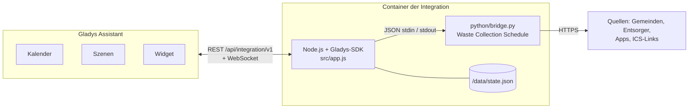
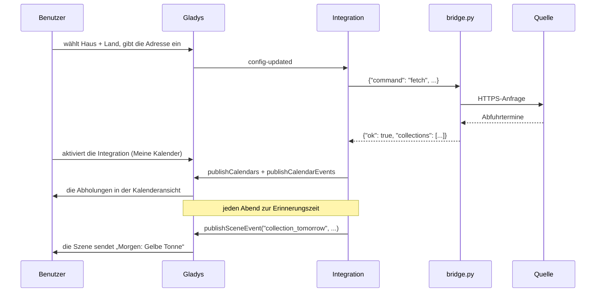
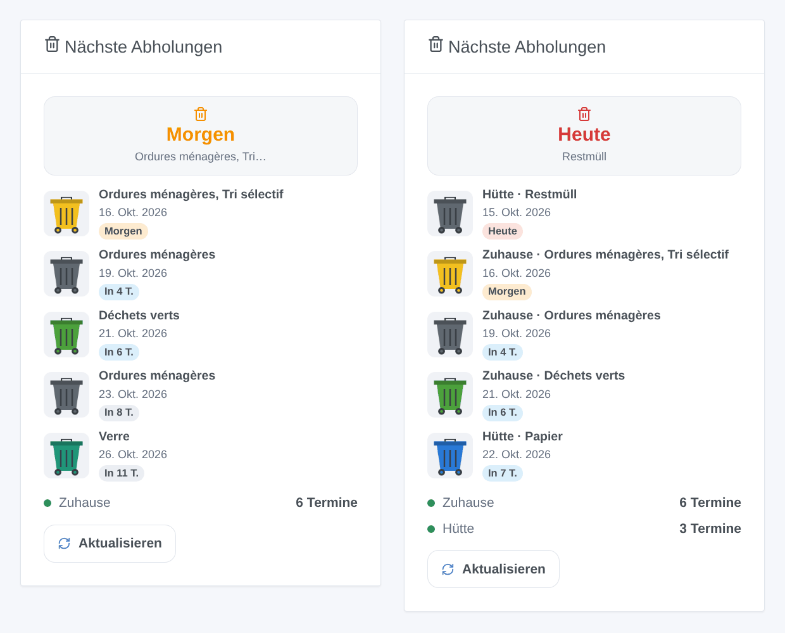

# Waste Collection Schedule für Gladys Assistant

[English](README.md) | [Français](README.fr.md) | **Deutsch** | [Español](README.es.md)

[](LICENSE)
[](https://github.com/William-De71/gladys-waste-collection-schedule/releases)
[](https://github.com/William-De71/gladys-waste-collection-schedule/actions/workflows/release.yml)
[](https://gladysassistant.com)


Die Abfuhrtermine Ihrer Adresse in Gladys Assistant, aus den fast 1.000 Quellen von [Waste Collection Schedule](https://github.com/mampfes/hacs_waste_collection_schedule) (Gemeinden, Entsorger, Apps und ICS-Kalenderlinks aus rund dreißig Ländern): im Gladys-Kalender, als Erinnerung am Vorabend und in einem Dashboard-Widget.

## Funktionen

- **Fast 1.000 Quellen**: die Bibliothek Waste Collection Schedule selbst (MIT), im Image enthalten und fest versioniert, wöchentlich per Workflow aktualisiert. Jeder ICS-Kalenderlink funktioniert ebenfalls.
- **Bis zu drei Abfuhrpläne** (ein Ferienhaus oder eine zweite Quelle für dieselbe Adresse).
- **Kalender**: ein Kalender pro Abfuhrplan für jeden Benutzer, der die Integration unter **Meine Kalender** aktiviert, mit einem ganztägigen Termin pro Abholung und Abfallart.
- **Dashboard-Widget** „Nächste Abholungen“, mit einer Tonne in der passenden Farbe für jeden Abholtag.
- **Szenen-Auslöser**: Abholung morgen (Erinnerung am Abend), Abfallart wird morgen abgeholt, Abholung heute (Erinnerung am Morgen), Aktualisierung fehlgeschlagen.
- **Szenen-Aktionen**: nächste Abholung abrufen (wahlweise einer Abfallart), Abfuhrtermine aktualisieren.
- **Schaltflächen in der Konfiguration**: Quelle nach Ort, Entsorger oder Land suchen; Abfuhrpläne testen.
- **Abfallarten umbenennen und ausblenden**, Aktualisierungsintervall wählen, Texte auf Englisch, Französisch, Deutsch und Spanisch.

## Funktionsweise




Ein Takt im Minutenabstand fragt die fälligen Abfuhrpläne ab (je ein kurzer Python-Prozess, einer nach dem anderen), überträgt die Kalender jedes Benutzers, der die Integration aktiviert hat, aktualisiert das Widget um Mitternacht und löst die Erinnerungen aus. Für jeden Abfuhrplan findet `python/bridge.py` zuerst die Quelle: einen Modulnamen unverändert, sonst die Einträge der Bibliothek im gewählten Land, zuerst den exakten Titel, dann die Titel, die damit beginnen, dann die, die alle Wörter enthalten (gesucht mit Quelle, sonst mit Ort); ein Gleichstand zwischen verschiedenen Quellen ist ein Fehler „ambiguous“, der sie auflistet, nie eine Vermutung. Dann gibt es die Adressfelder an die gleichbedeutenden Parameter der Quelle weiter (`FIELD_PARAMS`, exakte Namen), die erweiterten Parameter zuletzt. Eine französische Quelle, die einen INSEE-Code verlangt, erhält ihn von geo.api.gouv.fr anhand von Ort und Postleitzahl.



## Kalender

Ein Kalender pro Abfuhrplan („Müllabfuhr – Zuhause“, in der Sprache jedes Benutzers) für jeden Benutzer, der die Integration unter **Meine Kalender** aktiviert hat, externe ID `ext:<selector>:<user>:schedule-<1|2|3>`. Ein ganztägiger Termin pro Abholung und Abfallart, benannt nach der Abfallart, von 35 Tagen zurück bis 400 Tage voraus. Das Zeitfenster wird bei Änderungen der Quelle und einmal täglich neu übertragen: Eine Abholung, die die Quelle verschiebt oder streicht, wird auch in Gladys verschoben oder verschwindet. Ein Kalender ist anfangs privat: **Mit dem Haushalt teilen** macht ihn für den Haushalt und die Kalender-Auslöser der Szenen sichtbar. Widget und Szenen-Auslöser der Integration hängen nicht davon ab.

## Transport

**Nur Cloud** (`"transports": ["cloud"]`): Jede Quelle ist eine Website oder eine API im Internet, die standardmäßig alle 12 Stunden von Ihrem Gladys aus abgefragt wird. Der Katalog zeigt das Cloud-Abzeichen; es gibt keine Schaltfläche „Lokale Verbindung bevorzugen“ (nur ein Kanal). Ihre Adresse, oder was Ihre Quelle braucht (Straße, Hausnummer, Kalenderlink), geht an diese Quelle und an niemanden sonst; nichts läuft über einen Gladys-Server. Für die wenigen französischen Quellen, die einen INSEE-Code verlangen, gehen Ort und Postleitzahl (nie die Straße) an geo.api.gouv.fr, die öffentliche Geo-API des französischen Staates. Die Berechtigung `location` erlaubt der Integration, die Häuser von Gladys zu lesen (`GET /house`), nur für ihren Namen: Die Koordinaten kommen mit, werden aber nicht verwendet.

## Widget



**Nächste Abholungen**: die nächste Abholung (Kachel), die nächsten Abholtage mit einer Tonne in der passenden Farbe (Liste), der Zustand jedes Abfuhrplans und eine Schaltfläche **Aktualisieren**. Einstellungen: der angezeigte Abfuhrplan (alle oder einer), die Zahl der Abholtage (3, 5 oder 8), die Schaltfläche Aktualisieren. Das Bild oben erzeugt `docs/illustrations/render.sh` aus dem echten Code des Widgets, dargestellt wie im Gladys-Frontend.

## Szenen-Auslöser und -Aktionen

| Auslöser              | Wann                                             | Filter                | Variablen                                       |
| --------------------- | ------------------------------------------------ | --------------------- | ----------------------------------------------- |
| `collection_tomorrow` | am Vorabend eines Abholtags, zur Erinnerungszeit | Abfuhrplan            | `waste_types`, `count`, `date`, `schedule_name` |
| `waste_type_tomorrow` | zum selben Zeitpunkt, einmal pro Abfallart       | Abfuhrplan, Abfallart | `waste_type`, `date`, `schedule_name`           |
| `collection_today`    | am Morgen eines Abholtags, zur Morgenzeit        | Abfuhrplan            | `waste_types`, `count`, `date`, `schedule_name` |
| `fetch_failed`        | einmal, wenn eine Quelle zu versagen beginnt     | Abfuhrplan            | `schedule_name`, `source`, `error`              |

| Aktion                | Felder                           | Ausgaben                                                    |
| --------------------- | -------------------------------- | ----------------------------------------------------------- |
| `get_next_collection` | Abfuhrplan, Abfallart (optional) | `found`, `date`, `days`, `waste_types`, `schedule_name`     |
| `refresh`             | Abfuhrplan                       | `success`, `error`, `next_date`, `next_waste_types`, `days` |

Beispiele:

- **Müllabfuhr morgen** → „Morgen: {{triggerEvent.data.waste_types}}, Tonnen rausstellen“ senden.
- **Abfallart wird morgen abgeholt**, Abfallart „Gelbe Tonne“ → das Licht im Flur 10 Minuten gelb leuchten lassen.
- **Müllabfuhr heute** → wenn das Garagentor zu ist, „Heute Morgen ist Abholung“ senden.

Eine Erinnerung kommt einmal pro Abholung, auch nach einem Neustart, bis zu 3 Stunden später, wenn Gladys aus war. `fetch_failed` wird nie nach einer von einer Szene angeforderten Aktualisierung ausgelöst (keine Schleife).

## Voraussetzungen

- Gladys Assistant **5.3.0 oder neuer** (Kalender-Integrationen, Katalog-Schlagwörter und -Länder von Gladys 5.3; ältere Instanzen können die Integration nicht installieren).
- Internetzugang für Gladys.
- Eine Quelle für Ihre Adresse: siehe die [Liste der Quellen](https://github.com/mampfes/hacs_waste_collection_schedule#supported-service-providers) oder die Quelle **ics** mit einem Kalenderlink.

## Installation

- **Aus dem Store**: Integrationen → „Waste Collection Schedule“ suchen → Installieren.
- **Über die Repository-URL**: Integrationen → Integration installieren → `https://github.com/William-De71/gladys-waste-collection-schedule` einfügen.
- **Entwicklermodus**: Integrationen → Integration installieren → Entwicklermodus, mit dem Manifest eines Builds (die Zusammenfassung des Workflows „Build and publish image“ zeigt es).

## Konfiguration

| Feld                        | Typ    | Standard | Bedeutung                                                                                                                                |
| --------------------------- | ------ | -------- | ---------------------------------------------------------------------------------------------------------------------------------------- |
| `house_1` … `house_3`       | select |          | Haus von Gladys (`source: "houses"`): gibt Kalender und Widget seinen Namen; zwei Abfuhrpläne eines Hauses tragen die Quelle in Klammern |
| `country_1` … `country_3`   | select |          | Land der Bibliothek, in dem die Quelle gesucht wird                                                                                      |
| `city_1` … `city_3`         | string |          | Ort: findet die Quelle, wenn Quelle leer ist, und füllt ihren Ortsparameter                                                              |
| `postcode_1` … `postcode_3` | string |          | Postleitzahl                                                                                                                             |
| `street_1` … `street_3`     | string |          | Straße                                                                                                                                   |
| `number_1` … `number_3`     | string |          | Hausnummer                                                                                                                               |
| `source_1` … `source_3`     | string |          | Quelle (optional): Titel einer Quelle oder Modulname, z. B. `AWM München`; leer, über den Ort gefunden                                   |
| `url_1` … `url_3`           | string |          | ICS-Link (optional): allein die Quelle `ics`                                                                                             |
| `args_1` … `args_3`         | string |          | Erweiterte Parameter: `schlüssel=wert; schlüssel=wert`; sie haben Vorrang vor den Feldern oben                                           |
| `rename`                    | string |          | `Original=Neu; …`                                                                                                                        |
| `hide`                      | string |          | `Art; Art`                                                                                                                               |
| `reminder_time`             | select | `19:00`  | Erinnerung am Abend, 16:00 bis 22:00 oder `off`                                                                                          |
| `morning_time`              | select | `06:00`  | Erinnerung am Morgen, 05:00 bis 10:00 oder `off`                                                                                         |
| `refresh_hours`             | select | `12`     | Aktualisierung alle 6, 12 oder 24 Stunden                                                                                                |
| `language`                  | select | `en`     | Sprache der an Szenen gesendeten Texte (Standardnamen, Fehler)                                                                           |

`name_1` … `name_3` sind zugunsten des Hauses aus dem Formular verschwunden; eine ältere Konfiguration benennt ihre Abfuhrpläne weiterhin damit.

Schaltflächen der Konfigurationsseite: **Quelle suchen** (Suche nach Ort, Entsorger oder Land: was jede Quelle braucht, mit den Bezeichnungen des Formulars, und ihr Name für Quelle, wenn der Ort nicht reicht) und **Abfuhrpläne testen** (fragt jede Quelle sofort ab und zeigt, was sie geliefert hat, oder was nicht stimmt: ein fehlender Wert, mehrere mögliche Quellen, die Vorschläge der Quelle).

## Verwendung

1. Finden Sie Ihre Quelle mit **Quelle suchen**, füllen Sie Abfuhrplan 1 aus, speichern Sie, drücken Sie **Abfuhrpläne testen**.
2. Jeder Benutzer drückt **Für mich aktivieren** unter **Meine Kalender**.
3. Das Widget **Nächste Abholungen** zu einem Dashboard hinzufügen.
4. Eine Szene auf **Müllabfuhr morgen** anlegen, um erinnert zu werden.

Die Benutzerdokumentation steht in [docs/de.md](docs/de.md) ([en](docs/en.md), [fr](docs/fr.md), [es](docs/es.md)).

## Lokale Entwicklung

```bash
npm install
scripts/dev-setup.sh          # das fest versionierte Waste Collection Schedule in .wcs/ (lib + venv)
WCS_PYTHON=.wcs/venv/bin/python WCS_LIB_DIR=.wcs/lib WCS_DATA_DIR=.wcs/data \
  GLADYS_HOST_API_URL=http://localhost:1443 \
  GLADYS_INTEGRATION_TOKEN=… GLADYS_INTEGRATION_SELECTOR=… \
  DEBUG=gladys-integration-sdk node index.js
```

| Variable       | Standard                  | Zweck                                                                 |
| -------------- | ------------------------- | --------------------------------------------------------------------- |
| `WCS_PYTHON`   | `python3`                 | Python-Interpreter mit den Abhängigkeiten                             |
| `WCS_LIB_DIR`  | `/app/python/lib`         | Ordner des Pakets `waste_collection_schedule`                         |
| `WCS_BRIDGE`   | `python/bridge.py`        | das Brückenskript                                                     |
| `WCS_DATA_DIR` | `/data`                   | Zustandsdatei und temporäre Dateien                                   |
| `WCS_DEBUG`    | nicht gesetzt             | Debug-Protokolle der Quellen (stderr)                                 |
| `WCS_GEO_API`  | `https://geo.api.gouv.fr` | Suche des INSEE-Codes (die Tests leiten sie auf einen lokalen Server) |

Eine Adresse direkt testen: `echo '{"command": "fetch", "country": "France", "address": {"city": "Bordeaux", "street": "Cours Pasteur", "number": "20"}}' | WCS_LIB_DIR=.wcs/lib .wcs/venv/bin/python -I python/bridge.py`.

| Skript                            | Was es tut                               |
| --------------------------------- | ---------------------------------------- |
| `npm test`                        | die Tests (`node --test`), ohne Netzwerk |
| `npm run lint`                    | ESLint                                   |
| `npm run format` / `format:check` | Prettier                                 |
| `docs/illustrations/render.sh`    | erzeugt die Widget-Illustrationen neu    |
| `scripts/build-cover.sh`          | erzeugt `cover.jpg` aus `cover.svg` neu  |

## Tests

`npm test` lässt die ganze Integration gegen das Fake-Gladys des SDK laufen (Kalender, Erinnerungen um Mitternacht und bei der Zeitumstellung, Widget-Inhalt geprüft mit `validateWidgetContent`, Kalender), das echte `python/bridge.py` gegen eine Ersatzbibliothek, das Manifest gegen den Code, die Übersetzungen und das Release-Skript. Die CI baut außerdem das Image und startet es wie Gladys (schreibgeschützt, 256 MB, ohne Netzwerk): Die Engine antwortet und jede enthaltene Quelle lässt sich importieren.

## Release-Prozess

Jeder Merge auf `main` veröffentlicht eine Version, wenn seine Commits es rechtfertigen, ohne manuellen Schritt:

```mermaid
flowchart LR
  A[Merge auf main] --> B[CI: Prettier, ESLint,<br/>Tests, Docker-Build]
  B --> C[nächste Version aus den<br/>Conventional Commits]
  C --> D[Abschnitt in CHANGELOG.md]
  D --> E[Commit chore release<br/>+ Tag vX.Y.Z]
  E --> F[Image :X.Y.Z + :latest<br/>amd64 + arm64]
  F --> G[main rückt auf den<br/>Release-Commit vor]
  G --> H[GitHub Release]
  H --> I[Prüfung: anonymer Pull,<br/>Store-Validator, Topic]
```



- `feat` → Minor, `fix` / `perf` → Patch, `!` oder `BREAKING CHANGE:` → Major (ein Minor unter 1.0.0). `docs`, `chore`, `ci`, `test`, `style`, `refactor`, `build` allein veröffentlichen nichts.
- Der Titel des Pull Requests wird zum Squash-Commit und damit zur Changelog-Zeile: auf Englisch, für den Benutzer (`feat(widgets): …`). `pr-title.yml` prüft ihn. `CHANGELOG.md` nie von Hand bearbeiten.
- Das Image existiert, bevor `main` seine Version ankündigt (der Store indexiert `main`).
- 1.0.0 ist eine manuelle Entscheidung: Actions → Release → Run workflow, `release-as: 1.0.0`. `dry-run` zeigt Version und Changelog, ohne zu veröffentlichen.
- **Geschütztes `main`**: Das Release pusht einen Commit auf `main`. Mit Branch-Schutz oder Ruleset GitHub Actions die Umgehung erlauben (oder eine GitHub App nutzen), sonst endet das Release nach dem Image.
- **Updates von Waste Collection Schedule**: `wcs-update.yml` öffnet bei jeder Upstream-Version einen Pull Request (Settings → Actions → General → „Allow GitHub Actions to create and approve pull requests“ aktivieren). Ein von GitHub Actions geöffneter Pull Request startet keinen Workflow: schließen und wieder öffnen, um die CI zu starten.
- Nach dem ersten Release das Paket öffentlich machen: Package settings → Change visibility → Public.

## Fehlerbehebung

- **Abfuhrpläne testen** erklärt die meisten Probleme, Abfuhrplan für Abfuhrplan.
- **Keine Quelle gefunden**: Prüfen Sie das Land oder tragen Sie den Namen Ihres Entsorgers (von **Quelle suchen** geliefert) unter Quelle (optional) ein.
- **Mehrere Quellen passen**: Übernehmen Sie die richtige, wie aufgelistet, unter Quelle (optional).
- **Ein Wert fehlt**: Die Meldung nennt das auszufüllende Feld; ein Parameter ohne Feld kommt als `schlüssel=wert` unter Erweiterte Parameter.
- **INSEE-Code**: Ort nicht gefunden oder mehrere Orte dieses Namens: Geben Sie die Postleitzahl an.
- Eine hier defekte Quelle ist meist auch in Home Assistant defekt: prüfen und dann bei [Waste Collection Schedule](https://github.com/mampfes/hacs_waste_collection_schedule/issues) melden.
- Ein Kalender ist leer: **Diesen Kalender synchronisieren** unter **Meine Kalender** prüfen.
- Protokolle: der Reiter Protokolle der Integration; `DEBUG=gladys-integration-sdk` für die Details des SDK.

## Mitwirken

Issues und Pull Requests sind willkommen. `npm run format:check`, `npm run lint` und `npm test` ausführen, den Titel des Pull Requests als Conventional Commit schreiben und nach jeder Änderung am Widget-Inhalt `docs/illustrations/render.sh` erneut ausführen. Neue Quellen gehören zu [Waste Collection Schedule](https://github.com/mampfes/hacs_waste_collection_schedule).

## Sicherheit

Siehe [SECURITY.md](SECURITY.md). Die Engine läuft mit einer minimalen Umgebung (nie mit dem Gladys-Token) im schreibgeschützten Container der Integration.

## Lizenz

[Apache-Lizenz 2.0](LICENSE), siehe auch [NOTICE](NOTICE). Das Image enthält [Waste Collection Schedule](https://github.com/mampfes/hacs_waste_collection_schedule) (MIT, © Steffen Zimmermann). Nicht verbunden mit Waste Collection Schedule oder den Entsorgern.
