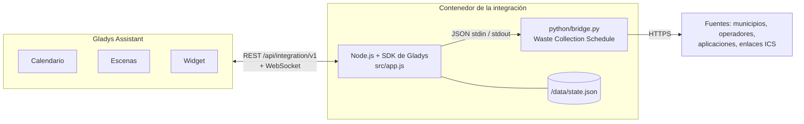
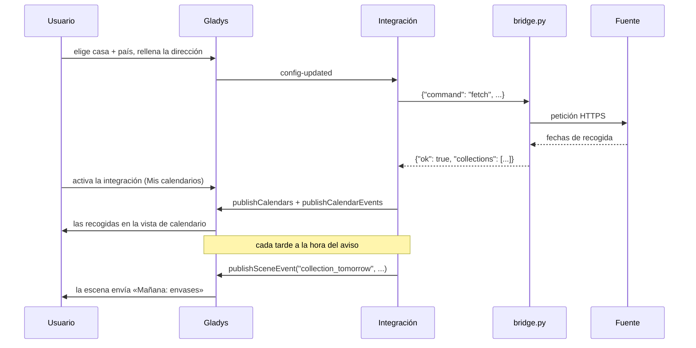
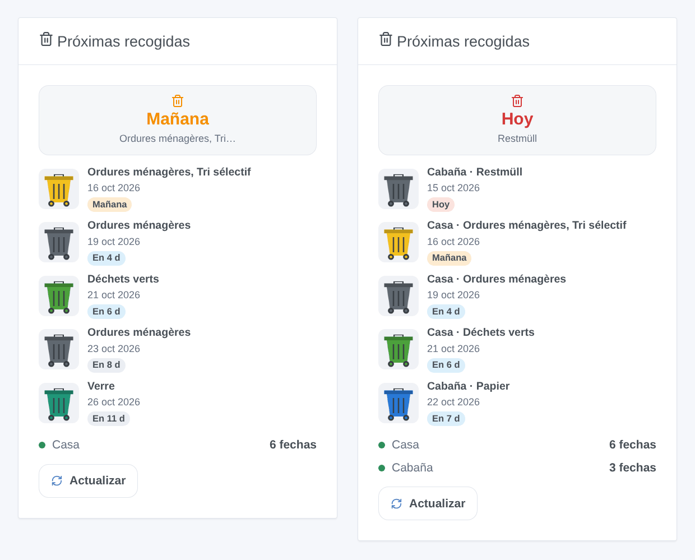

# Waste Collection Schedule para Gladys Assistant

[English](README.md) | [Français](README.fr.md) | [Deutsch](README.de.md) | **Español**

[](LICENSE)
[](https://github.com/William-De71/gladys-waste-collection-schedule/releases)
[](https://github.com/William-De71/gladys-waste-collection-schedule/actions/workflows/release.yml)
[](https://gladysassistant.com)


Las fechas de recogida de residuos de su dirección en Gladys Assistant, gracias a las casi 1.000 fuentes de [Waste Collection Schedule](https://github.com/mampfes/hacs_waste_collection_schedule) (municipios, operadores de residuos, aplicaciones y enlaces de calendario ICS de una treintena de países): en el calendario de Gladys, como aviso la víspera por la tarde y en un widget de panel.

## Funcionalidades

- **Casi 1.000 fuentes**: la propia biblioteca Waste Collection Schedule (MIT), incluida y con versión fija en la imagen, actualizada por un flujo de trabajo semanal. Cualquier enlace de calendario ICS funciona también.
- **Hasta tres calendarios de recogida** (una segunda residencia, o una segunda fuente para la misma dirección).
- **Calendario**: un calendario por fuente para cada usuario que active la integración en **Mis calendarios**, con un evento de día completo por recogida y tipo de residuo.
- **Widget de panel** «Próximas recogidas», con un contenedor del color adecuado para cada día de recogida.
- **Disparadores de escena**: recogida mañana (aviso de la tarde), tipo de residuo recogido mañana, recogida hoy (aviso de la mañana), error de actualización.
- **Acciones de escena**: obtener la próxima recogida (opcionalmente de un tipo de residuo), actualizar las fechas de recogida.
- **Botones de configuración**: buscar una fuente por municipio, operador o país; probar los calendarios.
- **Renombrar y ocultar tipos de residuos**, elegir la frecuencia de actualización, textos en inglés, francés, alemán y español.

## Funcionamiento




Un temporizador de un minuto consulta los calendarios que tocan (un proceso Python corto cada uno, de uno en uno), envía los calendarios de cada usuario que activó la integración, actualiza el widget a medianoche y lanza los avisos. Para cada calendario, `python/bridge.py` encuentra primero la fuente: un nombre de módulo tal cual, si no las entradas de la biblioteca en el país elegido, primero el título exacto, luego los títulos que empiezan por el texto, luego los que contienen todas sus palabras (búsqueda con Fuente, si no con Municipio); un empate entre fuentes distintas es un error «ambiguous» que las lista, nunca una suposición. Después pasa los campos de dirección a los parámetros de la fuente que significan lo mismo (`FIELD_PARAMS`, nombres exactos), los parámetros avanzados al final. Una fuente francesa que pide un código INSEE lo obtiene de geo.api.gouv.fr con el municipio y el código postal.



## Calendario

Un calendario por fuente («Recogida de residuos – Casa», en el idioma de cada usuario) para cada usuario que activó la integración en **Mis calendarios**, identificador externo `ext:<selector>:<user>:schedule-<1|2|3>`. Un evento de día completo por recogida y tipo de residuo, con el nombre del tipo, desde 35 días atrás hasta 400 días adelante. La ventana se envía de nuevo cuando cambia la fuente y una vez al día: una recogida que la fuente mueve o suprime se mueve o desaparece también en Gladys. Un calendario empieza siendo privado: **Compartir con el hogar** lo hace visible para el hogar y para los disparadores de calendario de las escenas. El widget y los disparadores de la integración no dependen de ello.

## Transporte

**Solo nube** (`"transports": ["cloud"]`): cada fuente es un sitio web o una API en Internet, consultada desde su Gladys cada 12 horas por defecto. El catálogo muestra la insignia de nube; no hay botón «Preferir la conexión local» (un solo canal). Su dirección, o lo que necesite su fuente (una calle, un número, un enlace de calendario), se envía a esa fuente y a nadie más; nada pasa por un servidor de Gladys. Para las pocas fuentes francesas que piden un código INSEE, el municipio y el código postal (nunca la calle) se envían a geo.api.gouv.fr, la API geográfica pública del Estado francés. El permiso `location` permite a la integración leer las casas de Gladys (`GET /house`) solo para su nombre: las coordenadas llegan con ellas, pero no se usan.

## Widget



**Próximas recogidas**: la próxima recogida (mosaico), los próximos días de recogida con un contenedor del color adecuado (lista), el estado de cada calendario y un botón **Actualizar**. Ajustes: el calendario mostrado (todos o uno), el número de días de recogida (3, 5 u 8), el botón Actualizar. La imagen de arriba la genera `docs/illustrations/render.sh` a partir del código real del widget, dibujada como el front de Gladys.

## Disparadores y acciones de escena

| Disparador            | Cuándo                                                  | Filtros                     | Variables                                       |
| --------------------- | ------------------------------------------------------- | --------------------------- | ----------------------------------------------- |
| `collection_tomorrow` | la víspera de un día de recogida, a la hora del aviso   | calendario                  | `waste_types`, `count`, `date`, `schedule_name` |
| `waste_type_tomorrow` | en el mismo momento, una vez por tipo de residuo        | calendario, tipo de residuo | `waste_type`, `date`, `schedule_name`           |
| `collection_today`    | la mañana de un día de recogida, a la hora de la mañana | calendario                  | `waste_types`, `count`, `date`, `schedule_name` |
| `fetch_failed`        | una vez, cuando una fuente empieza a fallar             | calendario                  | `schedule_name`, `source`, `error`              |

| Acción                | Campos                                 | Salidas                                                     |
| --------------------- | -------------------------------------- | ----------------------------------------------------------- |
| `get_next_collection` | calendario, tipo de residuo (opcional) | `found`, `date`, `days`, `waste_types`, `schedule_name`     |
| `refresh`             | calendario                             | `success`, `error`, `next_date`, `next_waste_types`, `days` |

Ejemplos:

- **Recogida de residuos mañana** → enviar «Mañana: {{triggerEvent.data.waste_types}}, saque los contenedores».
- **Tipo de residuo recogido mañana**, tipo «Vidrio» → encender la luz de la entrada en verde durante 10 minutos.
- **Recogida de residuos hoy** → si la puerta del garaje está cerrada, enviar «Recogida esta mañana».

Un aviso se envía una vez por recogida, incluso tras un reinicio, hasta 3 horas tarde si Gladys estaba apagado. `fetch_failed` nunca se lanza tras una actualización pedida por una escena (sin bucle).

## Requisitos

- Gladys Assistant **5.2.0 o posterior** (integraciones de calendario; las instancias más antiguas no pueden instalar la integración).
- Acceso a Internet desde Gladys.
- Una fuente para su dirección: vea la [lista de fuentes](https://github.com/mampfes/hacs_waste_collection_schedule#supported-service-providers), o la fuente **ics** con un enlace de calendario.

## Instalación

- **Desde el store**: Integraciones → buscar «Waste Collection Schedule» → Instalar.
- **Desde la URL del repositorio**: Integraciones → Instalar una integración → pegar `https://github.com/William-De71/gladys-waste-collection-schedule`.
- **Modo desarrollador**: Integraciones → Instalar una integración → Modo desarrollador, con el manifiesto de una compilación (el resumen del flujo «Build and publish image» lo muestra).

## Configuración

| Campo                       | Tipo   | Por defecto | Significado                                                                                                                                      |
| --------------------------- | ------ | ----------- | ------------------------------------------------------------------------------------------------------------------------------------------------ |
| `house_1` … `house_3`       | select |             | casa de Gladys (`source: "houses"`): da su nombre al calendario y al widget; dos calendarios de una misma casa llevan la fuente entre paréntesis |
| `country_1` … `country_3`   | select |             | país de la biblioteca, donde se busca la fuente                                                                                                  |
| `city_1` … `city_3`         | string |             | Municipio: encuentra la fuente cuando Fuente está vacía, y rellena su parámetro de municipio                                                     |
| `postcode_1` … `postcode_3` | string |             | Código postal                                                                                                                                    |
| `street_1` … `street_3`     | string |             | Calle                                                                                                                                            |
| `number_1` … `number_3`     | string |             | Número                                                                                                                                           |
| `source_1` … `source_3`     | string |             | Fuente (opcional): título de una fuente o nombre de módulo, p. ej. `Grand Besançon Métropole`; vacía, se encuentra por el municipio              |
| `url_1` … `url_3`           | string |             | Enlace ICS (opcional): solo, la fuente `ics`                                                                                                     |
| `args_1` … `args_3`         | string |             | Parámetros avanzados: `clave=valor; clave=valor`; prevalecen sobre los campos de arriba                                                          |
| `rename`                    | string |             | `Original=Nuevo; …`                                                                                                                              |
| `hide`                      | string |             | `Tipo; Tipo`                                                                                                                                     |
| `reminder_time`             | select | `19:00`     | aviso de la tarde, de 16:00 a 22:00 u `off`                                                                                                      |
| `morning_time`              | select | `06:00`     | aviso de la mañana, de 05:00 a 10:00 u `off`                                                                                                     |
| `refresh_hours`             | select | `12`        | actualización cada 6, 12 o 24 horas                                                                                                              |
| `language`                  | select | `en`        | idioma de los textos enviados a las escenas (nombres por defecto, errores)                                                                       |

`name_1` … `name_3` salieron del formulario en favor de la casa; una configuración antigua sigue nombrando sus calendarios con ellos.

Botones de la página de configuración: **Buscar una fuente** (búsqueda por municipio, operador o país: lo que pide cada fuente, con las etiquetas del formulario, y su nombre para Fuente cuando el municipio no basta) y **Probar los calendarios** (consulta cada fuente ahora y muestra lo que devolvió, o lo que falla: un valor que falta, varias fuentes posibles, las sugerencias de la fuente).

## Uso

1. Encuentre su fuente con **Buscar una fuente**, rellene el calendario 1, guarde y pulse **Probar los calendarios**.
2. Cada usuario pulsa **Activar para mí** en **Mis calendarios**.
3. Añada el widget **Próximas recogidas** a un panel.
4. Cree una escena con **Recogida de residuos mañana** para recibir el aviso.

La documentación de usuario está en [docs/es.md](docs/es.md) ([en](docs/en.md), [fr](docs/fr.md), [de](docs/de.md)).

## Desarrollo local

```bash
npm install
scripts/dev-setup.sh          # el Waste Collection Schedule con versión fija en .wcs/ (lib + venv)
WCS_PYTHON=.wcs/venv/bin/python WCS_LIB_DIR=.wcs/lib WCS_DATA_DIR=.wcs/data \
  GLADYS_HOST_API_URL=http://localhost:1443 \
  GLADYS_INTEGRATION_TOKEN=… GLADYS_INTEGRATION_SELECTOR=… \
  DEBUG=gladys-integration-sdk node index.js
```

| Variable       | Por defecto               | Uso                                                                    |
| -------------- | ------------------------- | ---------------------------------------------------------------------- |
| `WCS_PYTHON`   | `python3`                 | intérprete Python con las dependencias                                 |
| `WCS_LIB_DIR`  | `/app/python/lib`         | carpeta del paquete `waste_collection_schedule`                        |
| `WCS_BRIDGE`   | `python/bridge.py`        | el script puente                                                       |
| `WCS_DATA_DIR` | `/data`                   | archivo de estado y archivos temporales                                |
| `WCS_DEBUG`    | sin definir               | registros de depuración de las fuentes (stderr)                        |
| `WCS_GEO_API`  | `https://geo.api.gouv.fr` | búsqueda del código INSEE (las pruebas la dirigen a un servidor local) |

Probar una dirección directamente: `echo '{"command": "fetch", "country": "France", "address": {"city": "Bordeaux", "street": "Cours Pasteur", "number": "20"}}' | WCS_LIB_DIR=.wcs/lib .wcs/venv/bin/python -I python/bridge.py`.

| Script                            | Qué hace                                     |
| --------------------------------- | -------------------------------------------- |
| `npm test`                        | las pruebas (`node --test`), sin red         |
| `npm run lint`                    | ESLint                                       |
| `npm run format` / `format:check` | Prettier                                     |
| `docs/illustrations/render.sh`    | regenera las ilustraciones del widget        |
| `scripts/build-cover.sh`          | regenera `cover.jpg` a partir de `cover.svg` |

## Pruebas

`npm test` ejecuta toda la integración contra el Gladys falso del SDK (calendarios, avisos alrededor de medianoche y de los cambios de hora, contenido del widget validado por `validateWidgetContent`, calendarios), el `python/bridge.py` real contra una biblioteca sustituta, el manifiesto frente al código, las traducciones y el script de release. La CI también construye la imagen y la arranca como Gladys (solo lectura, 256 MB, sin red): el motor responde y todas las fuentes incluidas se importan.

## Proceso de release

Cada fusión en `main` publica una versión cuando sus commits lo justifican, sin ningún paso manual:

```mermaid
flowchart LR
  A[fusión en main] --> B[CI: Prettier, ESLint,<br/>pruebas, build Docker]
  B --> C[siguiente versión según<br/>los Conventional Commits]
  C --> D[sección de CHANGELOG.md]
  D --> E[commit chore release<br/>+ tag vX.Y.Z]
  E --> F[imagen :X.Y.Z + :latest<br/>amd64 + arm64]
  F --> G[main avanza al<br/>commit de release]
  G --> H[GitHub Release]
  H --> I[verificación: pull anónimo,<br/>validador del store, topic]
```



- `feat` → menor, `fix` / `perf` → parche, `!` o `BREAKING CHANGE:` → mayor (una menor por debajo de 1.0.0). `docs`, `chore`, `ci`, `test`, `style`, `refactor`, `build` solos no publican nada.
- El título de la pull request se convierte en el commit squash y, por tanto, en la línea del changelog: escríbalo en inglés, para el usuario (`feat(widgets): …`). `pr-title.yml` lo comprueba. No edite nunca `CHANGELOG.md` a mano.
- La imagen existe antes de que `main` anuncie su versión (el store indexa `main`).
- La 1.0.0 es una decisión manual: Actions → Release → Run workflow, `release-as: 1.0.0`. `dry-run` muestra la versión y el changelog sin publicar nada.
- **`main` protegida**: la release empuja un commit a `main`. Con una protección de rama o un ruleset, permita que GitHub Actions la omita (o use una GitHub App); si no, la release se detiene tras la imagen.
- **Actualizaciones de Waste Collection Schedule**: `wcs-update.yml` abre una pull request con cada versión del proyecto de origen (active Settings → Actions → General → «Allow GitHub Actions to create and approve pull requests»). Una pull request abierta por GitHub Actions no lanza ningún flujo: ciérrela y vuelva a abrirla para lanzar la CI.
- Tras la primera release, haga público el paquete: Package settings → Change visibility → Public.

## Solución de problemas

- **Probar los calendarios** explica la mayoría de los problemas, calendario por calendario.
- **Ninguna fuente encontrada**: compruebe el país, o escriba el nombre de su operador de residuos (dado por **Buscar una fuente**) en Fuente (opcional).
- **Varias fuentes coinciden**: copie la correcta, tal como aparece, en Fuente (opcional).
- **Falta un valor**: el mensaje nombra el campo que rellenar; un parámetro sin campo va en Parámetros avanzados como `clave=valor`.
- **Código INSEE**: municipio no encontrado o varios municipios con ese nombre: añada el Código postal.
- Una fuente rota aquí suele estarlo también en Home Assistant: compruébelo y avise a [Waste Collection Schedule](https://github.com/mampfes/hacs_waste_collection_schedule/issues).
- Un calendario está vacío: compruebe **Sincronizar este calendario** en **Mis calendarios**.
- Registros: la pestaña Registros de la integración; `DEBUG=gladys-integration-sdk` para el detalle del SDK.

## Contribuir

Las issues y pull requests son bienvenidas. Ejecute `npm run format:check`, `npm run lint` y `npm test`, escriba el título de la pull request como Conventional Commit y vuelva a ejecutar `docs/illustrations/render.sh` tras cualquier cambio del contenido del widget. Las fuentes nuevas se proponen en [Waste Collection Schedule](https://github.com/mampfes/hacs_waste_collection_schedule).

## Seguridad

Vea [SECURITY.md](SECURITY.md). El motor se ejecuta con un entorno mínimo (nunca el token de Gladys), en el contenedor de solo lectura de la integración.

## Licencia

[Licencia Apache 2.0](LICENSE), vea también [NOTICE](NOTICE). La imagen incluye [Waste Collection Schedule](https://github.com/mampfes/hacs_waste_collection_schedule) (MIT, © Steffen Zimmermann). Sin relación con Waste Collection Schedule ni con los operadores de residuos.
