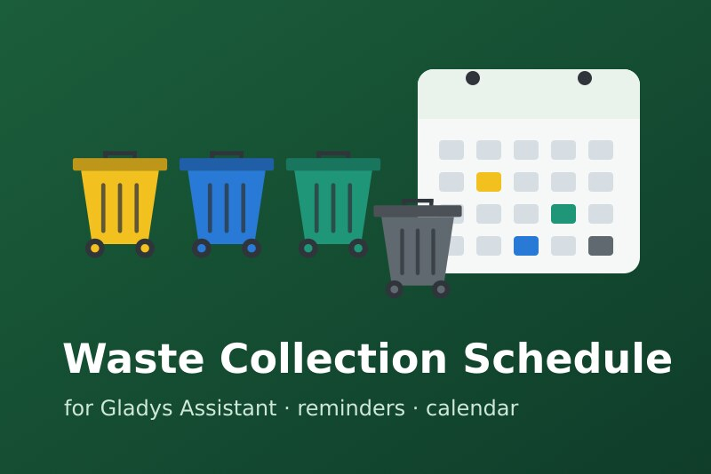
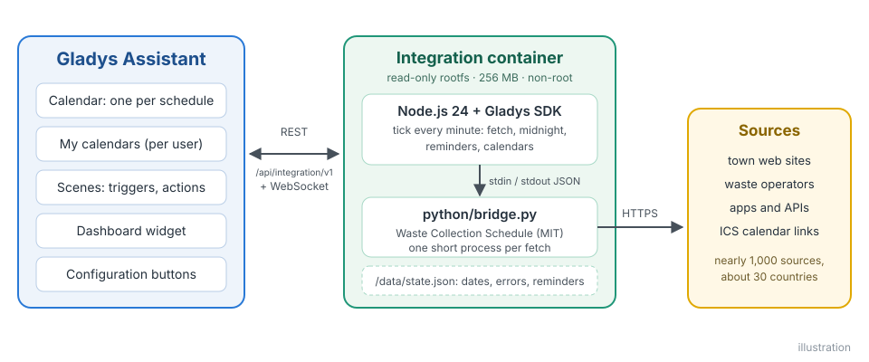
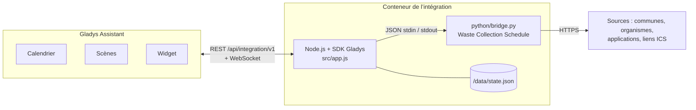
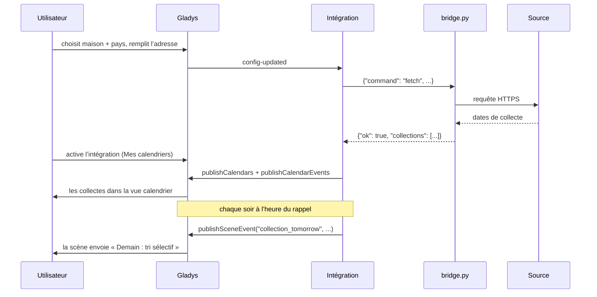
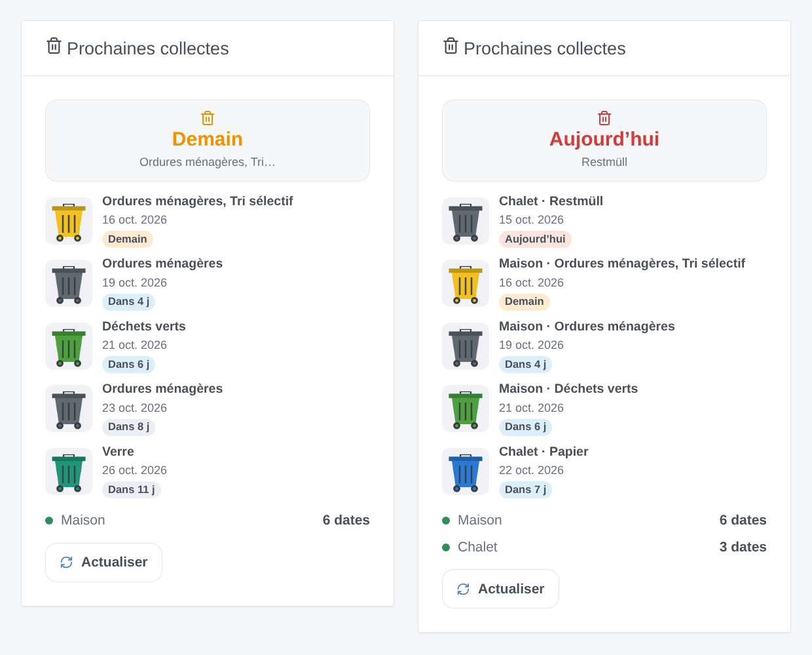

# Waste Collection Schedule pour Gladys Assistant

[English](README.md) | **Français** | [Deutsch](README.de.md) | [Español](README.es.md)

[](LICENSE)
[](https://github.com/William-De71/gladys-waste-collection-schedule/releases)
[](https://github.com/William-De71/gladys-waste-collection-schedule/actions/workflows/release.yml)
[](https://gladysassistant.com)



Les dates de collecte des déchets de votre adresse dans Gladys Assistant, grâce aux près de 1 000 sources de [Waste Collection Schedule](https://github.com/mampfes/hacs_waste_collection_schedule) (communes, organismes de collecte, applications et liens de calendrier ICS d’une trentaine de pays) : dans le calendrier de Gladys, en rappel la veille au soir et dans un widget de tableau de bord.

## Fonctionnalités

- **Près de 1 000 sources** : la bibliothèque Waste Collection Schedule elle-même (MIT), embarquée et épinglée dans l’image, mise à jour par un workflow hebdomadaire. N’importe quel lien de calendrier ICS fonctionne aussi.
- **Jusqu’à trois calendriers de collecte** (une résidence secondaire, ou une deuxième source pour la même adresse).
- **Calendrier** : un calendrier par source pour chaque utilisateur qui active l’intégration dans **Mes calendriers**, avec un événement sur la journée par collecte et par type de déchet.
- **Widget de tableau de bord** « Prochaines collectes », avec un bac de la bonne couleur pour chaque jour de collecte.
- **Déclencheurs de scène** : collecte demain (rappel du soir), type de déchet collecté demain, collecte aujourd’hui (rappel du matin), échec de mise à jour.
- **Actions de scène** : lire la prochaine collecte (éventuellement d’un type de déchet), mettre à jour les dates de collecte.
- **Boutons de configuration** : trouver une source par commune, organisme ou pays ; tester les calendriers.
- **Renommer et masquer des types de déchets**, choisir la fréquence de mise à jour, textes en anglais, français, allemand et espagnol.

## Fonctionnement





Un minuteur d’une minute interroge les calendriers dont c’est l’heure (un court processus Python chacun, un à la fois), publie les calendriers de chaque utilisateur qui a activé l’intégration, rafraîchit le widget à minuit et déclenche les rappels. Pour chaque calendrier, `python/bridge.py` trouve d’abord la source : un nom de module tel quel, sinon les entrées de la bibliothèque dans le pays choisi, le titre exact d’abord, puis les titres qui commencent par le texte, puis ceux qui contiennent tous ses mots (recherche avec Source, sinon avec Commune) ; une égalité entre sources différentes est une erreur « ambiguous » qui les liste, jamais un choix au hasard. Il donne ensuite les champs d’adresse aux paramètres de la source qui veulent dire la même chose (`FIELD_PARAMS`, noms exacts), les paramètres avancés en dernier. Une source française qui demande un code INSEE l’obtient de geo.api.gouv.fr avec la commune et le code postal.



## Calendrier

Un calendrier par source (« Collecte des déchets – Maison », dans la langue de chaque utilisateur) pour chaque utilisateur qui a activé l’intégration dans **Mes calendriers**, identifiant externe `ext:<selector>:<user>:schedule-<1|2|3>`. Un événement sur la journée par collecte et par type de déchet, nommé d’après le type, de 35 jours en arrière à 400 jours devant. La fenêtre est republiée quand la source change et une fois par jour : une collecte que la source déplace ou supprime est déplacée ou disparaît aussi dans Gladys. Un calendrier commence privé : **Partager avec le foyer** le rend visible au foyer et aux déclencheurs calendrier des scènes. Le widget et les déclencheurs de l’intégration n’en dépendent pas.

## Transport

**Cloud uniquement** (`"transports": ["cloud"]`) : chaque source est un site web ou une API sur Internet, interrogé depuis votre Gladys toutes les 12 heures par défaut. Le catalogue affiche le badge cloud ; il n’y a pas de bouton « Préférer la connexion locale » (canal unique). Votre adresse, ou ce dont votre source a besoin (une rue, un numéro, un lien de calendrier), est envoyée à cette source et à personne d’autre ; rien ne passe par un serveur de Gladys. Pour les rares sources françaises qui demandent un code INSEE, la commune et le code postal (jamais la rue) sont envoyés à geo.api.gouv.fr, l’API géographique publique de l’État. La permission `location` permet à l’intégration de lire les maisons de Gladys (`GET /house`) pour leur nom seulement : les coordonnées arrivent avec, mais ne sont pas utilisées.

## Widget



**Prochaines collectes** : la prochaine collecte (tuile), les prochains jours de collecte avec un bac de la bonne couleur (liste), l’état de chaque calendrier et un bouton **Actualiser**. Réglages : le calendrier affiché (tous ou un seul), le nombre de jours de collecte (3, 5 ou 8), le bouton Actualiser. L’image ci-dessus est générée par `docs/illustrations/render.sh` à partir du vrai code du widget, rendue comme le front de Gladys.

## Déclencheurs et actions de scène

| Déclencheur           | Quand                                                | Filtres                    | Variables                                       |
| --------------------- | ---------------------------------------------------- | -------------------------- | ----------------------------------------------- |
| `collection_tomorrow` | la veille d’un jour de collecte, à l’heure du rappel | calendrier                 | `waste_types`, `count`, `date`, `schedule_name` |
| `waste_type_tomorrow` | au même moment, une fois par type de déchet          | calendrier, type de déchet | `waste_type`, `date`, `schedule_name`           |
| `collection_today`    | le matin d’un jour de collecte, à l’heure du matin   | calendrier                 | `waste_types`, `count`, `date`, `schedule_name` |
| `fetch_failed`        | une fois, quand une source commence à échouer        | calendrier                 | `schedule_name`, `source`, `error`              |

| Action                | Champs                                  | Sorties                                                     |
| --------------------- | --------------------------------------- | ----------------------------------------------------------- |
| `get_next_collection` | calendrier, type de déchet (facultatif) | `found`, `date`, `days`, `waste_types`, `schedule_name`     |
| `refresh`             | calendrier                              | `success`, `error`, `next_date`, `next_waste_types`, `days` |

Exemples :

- **Collecte des déchets demain** → envoyer « Demain : {{triggerEvent.data.waste_types}}, pensez à sortir les bacs ».
- **Type de déchet collecté demain**, type « Verre » → allumer la lumière de l’entrée en vert pendant 10 minutes.
- **Collecte des déchets aujourd’hui** → si la porte du garage est fermée, envoyer « Collecte ce matin ».

Un rappel est envoyé une fois par collecte, même après un redémarrage, jusqu’à 3 heures en retard si Gladys était éteint. `fetch_failed` n’est jamais déclenché après une mise à jour demandée par une scène (pas de boucle).

## Prérequis

- Gladys Assistant **5.2.0 ou plus récent** (intégrations de calendriers ; les instances plus anciennes ne peuvent pas installer l’intégration).
- Un accès à Internet depuis Gladys.
- Une source pour votre adresse : voir la [liste des sources](https://github.com/mampfes/hacs_waste_collection_schedule#supported-service-providers), ou la source **ics** avec un lien de calendrier.

## Installation

- **Depuis le store** : Intégrations → chercher « Waste Collection Schedule » → Installer.
- **Depuis l’URL du dépôt** : Intégrations → Installer une intégration → coller `https://github.com/William-De71/gladys-waste-collection-schedule`.
- **Mode développeur** : Intégrations → Installer une intégration → Mode développeur, avec le manifeste d’un build (le résumé du workflow « Build and publish image » l’affiche).

## Configuration

| Champ                       | Type   | Défaut  | Signification                                                                                                                                         |
| --------------------------- | ------ | ------- | ----------------------------------------------------------------------------------------------------------------------------------------------------- |
| `house_1` … `house_3`       | select |         | maison de Gladys (`source: "houses"`) : donne son nom au calendrier et au widget ; deux calendriers d’une même maison ont la source entre parenthèses |
| `country_1` … `country_3`   | select |         | pays de la bibliothèque, où la source est cherchée                                                                                                    |
| `city_1` … `city_3`         | string |         | Commune : trouve la source quand Source est vide, et remplit son paramètre de commune                                                                 |
| `postcode_1` … `postcode_3` | string |         | Code postal                                                                                                                                           |
| `street_1` … `street_3`     | string |         | Rue                                                                                                                                                   |
| `number_1` … `number_3`     | string |         | Numéro                                                                                                                                                |
| `source_1` … `source_3`     | string |         | Source (facultatif) : titre d’une source ou nom de module, par ex. `Grand Besançon Métropole` ; vide, trouvée à partir de la commune                  |
| `url_1` … `url_3`           | string |         | Lien ICS (facultatif) : seul, la source `ics`                                                                                                         |
| `args_1` … `args_3`         | string |         | Paramètres avancés : `clé=valeur; clé=valeur` (JSON encore lu) ; ils l’emportent sur les champs ci-dessus                                             |
| `rename`                    | string |         | `Original=Nouveau; …`                                                                                                                                 |
| `hide`                      | string |         | `Type; Type`                                                                                                                                          |
| `reminder_time`             | select | `19:00` | rappel du soir, de 16 h à 22 h ou `off`                                                                                                               |
| `morning_time`              | select | `06:00` | rappel du matin, de 5 h à 10 h ou `off`                                                                                                               |
| `refresh_hours`             | select | `12`    | mise à jour toutes les 6, 12 ou 24 heures                                                                                                             |
| `language`                  | select | `en`    | langue des textes envoyés aux scènes (noms par défaut, erreurs)                                                                                       |

`name_1` … `name_3` ont quitté le formulaire au profit de la maison ; une ancienne configuration nomme encore ses calendriers avec.

Boutons de la page de configuration : **Trouver une source** (recherche par commune, organisme ou pays : ce que demande chaque source, avec les libellés du formulaire, et son nom pour Source quand la commune ne suffit pas) et **Tester les calendriers** (interroge chaque source maintenant et montre ce qu’elle a renvoyé, ou ce qui ne va pas : une valeur manquante, plusieurs sources possibles, les suggestions de la source).

## Utilisation

1. Trouvez votre source avec **Trouver une source**, remplissez le calendrier 1, enregistrez, appuyez sur **Tester les calendriers**.
2. Chaque utilisateur appuie sur **Activer pour moi** dans **Mes calendriers**.
3. Ajoutez le widget **Prochaines collectes** à un tableau de bord.
4. Créez une scène sur **Collecte des déchets demain** pour être prévenu.

La documentation utilisateur est dans [docs/fr.md](docs/fr.md) ([en](docs/en.md), [de](docs/de.md), [es](docs/es.md)).

## Développement local

```bash
npm install
scripts/dev-setup.sh          # le Waste Collection Schedule épinglé dans .wcs/ (lib + venv)
WCS_PYTHON=.wcs/venv/bin/python WCS_LIB_DIR=.wcs/lib WCS_DATA_DIR=.wcs/data \
  GLADYS_HOST_API_URL=http://localhost:1443 \
  GLADYS_INTEGRATION_TOKEN=… GLADYS_INTEGRATION_SELECTOR=… \
  DEBUG=gladys-integration-sdk node index.js
```

| Variable       | Défaut                    | Rôle                                                                  |
| -------------- | ------------------------- | --------------------------------------------------------------------- |
| `WCS_PYTHON`   | `python3`                 | interpréteur Python avec les dépendances                              |
| `WCS_LIB_DIR`  | `/app/python/lib`         | dossier du paquet `waste_collection_schedule`                         |
| `WCS_BRIDGE`   | `python/bridge.py`        | le script passerelle                                                  |
| `WCS_DATA_DIR` | `/data`                   | fichier d’état et fichiers temporaires                                |
| `WCS_DEBUG`    | non définie               | journaux de débogage des sources (stderr)                             |
| `WCS_GEO_API`  | `https://geo.api.gouv.fr` | recherche du code INSEE (les tests la dirigent vers un serveur local) |

Essayer une adresse directement : `echo '{"command": "fetch", "country": "France", "address": {"city": "Bordeaux", "street": "Cours Pasteur", "number": "20"}}' | WCS_LIB_DIR=.wcs/lib .wcs/venv/bin/python -I python/bridge.py`.

| Script                            | Rôle                                         |
| --------------------------------- | -------------------------------------------- |
| `npm test`                        | les tests (`node --test`), sans réseau       |
| `npm run lint`                    | ESLint                                       |
| `npm run format` / `format:check` | Prettier                                     |
| `docs/illustrations/render.sh`    | régénère les illustrations du widget         |
| `scripts/build-cover.sh`          | régénère `cover.jpg` à partir de `cover.svg` |

## Tests

`npm test` fait tourner toute l’intégration contre le faux Gladys du SDK (calendriers, rappels autour de minuit et des changements d’heure, contenu du widget validé par `validateWidgetContent`, calendriers), le vrai `python/bridge.py` contre une bibliothèque factice, le manifeste face au code, les traductions et le script de release. La CI construit aussi l’image et la démarre comme Gladys (lecture seule, 256 Mo, sans réseau) : le moteur répond et toutes les sources embarquées s’importent.

## Processus de release

Chaque fusion sur `main` publie une version quand ses commits le justifient, sans aucune action manuelle :

```mermaid
flowchart LR
  A[fusion sur main] --> B[CI : Prettier, ESLint,<br/>tests, build Docker]
  B --> C[version suivante d’après<br/>les Conventional Commits]
  C --> D[section du CHANGELOG.md]
  D --> E[commit chore release<br/>+ tag vX.Y.Z]
  E --> F[image :X.Y.Z + :latest<br/>amd64 + arm64]
  F --> G[main avance sur<br/>le commit de release]
  G --> H[GitHub Release]
  H --> I[vérification : pull anonyme,<br/>validateur du store, topic]
```



- `feat` → mineure, `fix` / `perf` → correctif, `!` ou `BREAKING CHANGE:` → majeure (une mineure sous 1.0.0). `docs`, `chore`, `ci`, `test`, `style`, `refactor`, `build` seuls ne publient rien.
- Le titre de la pull request devient le commit squash, donc la ligne du changelog : écrivez-le en anglais, pour l’utilisateur (`feat(widgets): …`). `pr-title.yml` le vérifie. Ne modifiez jamais `CHANGELOG.md` à la main.
- L’image existe avant que `main` annonce sa version (le store indexe `main`).
- La 1.0.0 est une décision manuelle : Actions → Release → Run workflow, `release-as: 1.0.0`. `dry-run` affiche la version et le changelog sans rien publier.
- **`main` protégée** : la release pousse un commit sur `main`. Avec une protection de branche ou un ruleset, autorisez GitHub Actions à la contourner (ou utilisez une GitHub App), sinon la release s’arrête après l’image.
- **Mises à jour de Waste Collection Schedule** : `wcs-update.yml` ouvre une pull request à chaque version amont (activez Settings → Actions → General → « Allow GitHub Actions to create and approve pull requests »). Une pull request ouverte par GitHub Actions ne lance aucun workflow : fermez-la puis rouvrez-la pour lancer la CI.
- Après la première release, rendez le package public : Package settings → Change visibility → Public.

## Dépannage

- **Tester les calendriers** explique la plupart des problèmes, calendrier par calendrier.
- **Aucune source trouvée** : vérifiez le pays, ou écrivez le nom de votre organisme de collecte (donné par **Trouver une source**) dans Source (facultatif).
- **Plusieurs sources correspondent** : recopiez la bonne, telle que listée, dans Source (facultatif).
- **Une valeur manque** : le message nomme le champ à remplir ; un paramètre sans champ va dans Paramètres avancés en `clé=valeur`.
- **Code INSEE** : commune introuvable ou plusieurs communes de ce nom : ajoutez le Code postal.
- Une source cassée ici l’est en général aussi dans Home Assistant : vérifiez, puis signalez-la à [Waste Collection Schedule](https://github.com/mampfes/hacs_waste_collection_schedule/issues).
- Un calendrier est vide : vérifiez **Synchroniser ce calendrier** dans **Mes calendriers**.
- Journaux : l’onglet Journaux de l’intégration ; `DEBUG=gladys-integration-sdk` pour le détail du SDK.

## Contribuer

Issues et pull requests bienvenues. Lancez `npm run format:check`, `npm run lint` et `npm test`, écrivez le titre de la pull request en Conventional Commit, et relancez `docs/illustrations/render.sh` après toute modification du contenu du widget. Les nouvelles sources se proposent en amont, dans [Waste Collection Schedule](https://github.com/mampfes/hacs_waste_collection_schedule).

## Sécurité

Voir [SECURITY.md](SECURITY.md). Le moteur tourne avec un environnement minimal (jamais le jeton Gladys), dans le conteneur en lecture seule de l’intégration.

## Licence

[Licence Apache 2.0](LICENSE), voir aussi [NOTICE](NOTICE). L’image embarque [Waste Collection Schedule](https://github.com/mampfes/hacs_waste_collection_schedule) (MIT, © Steffen Zimmermann). Sans lien avec Waste Collection Schedule ni avec les organismes de collecte.
