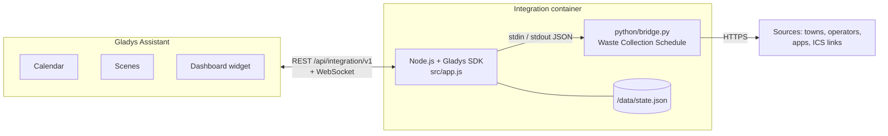
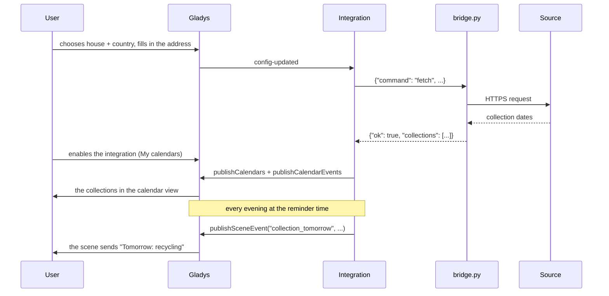
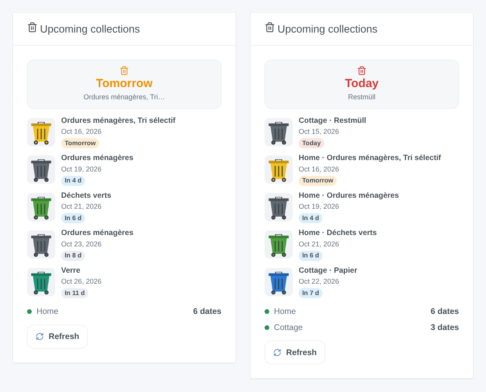

# Waste Collection Schedule for Gladys Assistant

**English** | [Français](README.fr.md) | [Deutsch](README.de.md) | [Español](README.es.md)

[](LICENSE)
[](https://github.com/William-De71/gladys-waste-collection-schedule/releases)
[](https://github.com/William-De71/gladys-waste-collection-schedule/actions/workflows/release.yml)
[](https://gladysassistant.com)


The waste collection dates of your address in Gladys Assistant, from the nearly 1,000 sources of [Waste Collection Schedule](https://github.com/mampfes/hacs_waste_collection_schedule) (towns, waste operators, apps and ICS calendar links of about thirty countries): in the Gladys calendar, as a reminder the evening before and in a dashboard widget.

## Features

- **Nearly 1,000 sources**: the Waste Collection Schedule library itself (MIT), bundled and pinned in the image, updated by a weekly workflow. Any ICS calendar link works too.
- **Up to three schedules** (a second home, or a second source for the same address).
- **Calendar**: one calendar per schedule for every user who enables the integration in **My calendars**, with an all-day event per collection and waste type.
- **Dashboard widget** "Upcoming collections", with a bin of the right color per collection day.
- **Scene triggers**: collection tomorrow (evening reminder), waste type collected tomorrow, collection today (morning reminder), update failed.
- **Scene actions**: get the next collection (optionally of one waste type), update the collection dates.
- **Configuration buttons**: find a source by town, operator or country; test the schedules.
- **Rename and hide waste types**, choose the update interval, texts in English, French, German and Spanish.

## How it works




A one-minute tick fetches the schedules that are due (one short Python process each, one at a time), pushes the calendars of every user who enabled the integration, refreshes the widget at midnight and fires the reminders. For each schedule, `python/bridge.py` first finds the source: a module name as is, otherwise the entries of the library in the chosen country, the exact title first, then the titles starting with it, then the titles containing every word (searched with Source, or else with Town); a tie between different sources is an "ambiguous" error listing them, never a guess. It then gives the address fields to the parameters of the source that mean the same thing (`FIELD_PARAMS`, exact names), the advanced parameters last. A French source asking for an INSEE code gets it from geo.api.gouv.fr with the town and the postcode.



## Calendar

One calendar per schedule ("Waste collection – Home", in the language of each user) for every user who enabled the integration in **My calendars**, external id `ext:<selector>:<user>:schedule-<1|2|3>`. One all-day event per collection and waste type, named after the waste type, from 35 days back to 400 days ahead. The window is pushed again when the source changes and once a day: a collection the source moves or drops moves or disappears in Gladys too. A calendar starts private: **Share with the household** shows it to the household and to the calendar triggers of the scenes. The widget and the scene triggers of the integration do not depend on it.

## Transport

**Cloud only** (`"transports": ["cloud"]`): every source is a web site or an API on the internet, asked from your Gladys every 12 hours by default. The catalog shows the cloud badge; there is no "Prefer the local connection" button (single channel). Your address, or what your source needs (a street, a house number, a calendar link), is sent to that source and to nobody else; nothing goes through a Gladys server. For the few French sources asking for an INSEE code, the town and the postcode (never the street) are sent to geo.api.gouv.fr, the public geographic API of the French State. The `location` permission lets the integration read the houses of Gladys (`GET /house`) for their name only: the coordinates come with them but are not used.

## Widget



**Upcoming collections**: the next collection (tile), the next collection days with a bin of the right color (list), the state of each schedule, and a **Refresh** button. Settings: the schedule shown (all or one), the number of collection days (3, 5 or 8), the Refresh button. The image above is generated by `docs/illustrations/render.sh` from the real code of the widget, rendered like the Gladys front.

## Scene triggers and actions

| Trigger               | When                                                      | Filters              | Variables                                       |
| --------------------- | --------------------------------------------------------- | -------------------- | ----------------------------------------------- |
| `collection_tomorrow` | the evening before a collection day, at the reminder time | schedule             | `waste_types`, `count`, `date`, `schedule_name` |
| `waste_type_tomorrow` | the same moment, once per waste type                      | schedule, waste type | `waste_type`, `date`, `schedule_name`           |
| `collection_today`    | the morning of a collection day, at the morning time      | schedule             | `waste_types`, `count`, `date`, `schedule_name` |
| `fetch_failed`        | once, when a source starts failing                        | schedule             | `schedule_name`, `source`, `error`              |

| Action                | Fields                          | Outputs                                                     |
| --------------------- | ------------------------------- | ----------------------------------------------------------- |
| `get_next_collection` | schedule, waste type (optional) | `found`, `date`, `days`, `waste_types`, `schedule_name`     |
| `refresh`             | schedule                        | `success`, `error`, `next_date`, `next_waste_types`, `days` |

Examples:

- **Waste collection tomorrow** → send "Tomorrow: {{triggerEvent.data.waste_types}}, take the bins out".
- **Waste type collected tomorrow**, waste type "Glass" → turn the hall light green for 10 minutes.
- **Waste collection today** → if the garage door is closed, send "Collection this morning".

A reminder fires once per collection, even across restarts, up to 3 hours late if Gladys was off. `fetch_failed` never fires after a refresh asked by a scene (no loop).

## Requirements

- Gladys Assistant **5.3.0 or later** (calendar integrations, catalog keywords and countries of Gladys 5.3; older instances cannot install the integration).
- Internet access from Gladys.
- A source for your address: see the [list of the sources](https://github.com/mampfes/hacs_waste_collection_schedule#supported-service-providers), or the **ics** source with a calendar link.

## Installation

- **From the store**: Integrations → search "Waste Collection Schedule" → Install.
- **From the repository URL**: Integrations → Install an integration → paste `https://github.com/William-De71/gladys-waste-collection-schedule`.
- **Developer mode**: Integrations → Install an integration → Developer mode, with the manifest of a build (the summary of the "Build and publish image" workflow prints it).

## Configuration

| Field                       | Type   | Default | Meaning                                                                                                                        |
| --------------------------- | ------ | ------- | ------------------------------------------------------------------------------------------------------------------------------ |
| `house_1` … `house_3`       | select |         | house of Gladys (`source: "houses"`): names the calendar and the widget; two schedules of one house get the source in brackets |
| `country_1` … `country_3`   | select |         | country of the library, where the source is searched                                                                           |
| `city_1` … `city_3`         | string |         | Town: finds the source when Source is empty, and fills its town parameter                                                      |
| `postcode_1` … `postcode_3` | string |         | Postcode                                                                                                                       |
| `street_1` … `street_3`     | string |         | Street                                                                                                                         |
| `number_1` … `number_3`     | string |         | Number                                                                                                                         |
| `source_1` … `source_3`     | string |         | Source (optional): title of a source or module name, e.g. `Grand Besançon Métropole`; empty, found from the town               |
| `url_1` … `url_3`           | string |         | ICS link (optional): alone, the `ics` source                                                                                   |
| `args_1` … `args_3`         | string |         | Advanced parameters: `key=value; key=value`; they win over the fields above                                                    |
| `rename`                    | string |         | `Original=New; …`                                                                                                              |
| `hide`                      | string |         | `Type; Type`                                                                                                                   |
| `reminder_time`             | select | `19:00` | evening reminder, 16:00 to 22:00 or `off`                                                                                      |
| `morning_time`              | select | `06:00` | morning reminder, 05:00 to 10:00 or `off`                                                                                      |
| `refresh_hours`             | select | `12`    | update every 6, 12 or 24 hours                                                                                                 |
| `language`                  | select | `en`    | language of the texts sent to scenes (default names, errors)                                                                   |

`name_1` … `name_3` left the form for the house; an older configuration still names its schedules with it.

Buttons of the configuration page: **Find a source** (search by town, operator or country: what each source needs, with the labels of the form, and its name for Source when the town is not enough) and **Test the schedules** (asks every source now and shows what it returned, or what is wrong: a missing value, several possible sources, the suggestions of the source).

## Usage

1. Find your source with **Find a source**, fill in schedule 1, save, press **Test the schedules**.
2. Each user presses **Enable for me** in **My calendars**.
3. Add the **Upcoming collections** widget to a dashboard.
4. Create a scene on **Waste collection tomorrow** to be reminded.

The user documentation is in [docs/en.md](docs/en.md) ([fr](docs/fr.md), [de](docs/de.md), [es](docs/es.md)).

## Local development

```bash
npm install
scripts/dev-setup.sh          # the pinned Waste Collection Schedule in .wcs/ (lib + venv)
WCS_PYTHON=.wcs/venv/bin/python WCS_LIB_DIR=.wcs/lib WCS_DATA_DIR=.wcs/data \
  GLADYS_HOST_API_URL=http://localhost:1443 \
  GLADYS_INTEGRATION_TOKEN=… GLADYS_INTEGRATION_SELECTOR=… \
  DEBUG=gladys-integration-sdk node index.js
```

| Variable       | Default                   | Use                                                      |
| -------------- | ------------------------- | -------------------------------------------------------- |
| `WCS_PYTHON`   | `python3`                 | Python interpreter with the requirements                 |
| `WCS_LIB_DIR`  | `/app/python/lib`         | folder of the `waste_collection_schedule` package        |
| `WCS_BRIDGE`   | `python/bridge.py`        | the bridge script                                        |
| `WCS_DATA_DIR` | `/data`                   | state file and temporary files                           |
| `WCS_DEBUG`    | unset                     | debug logs of the sources (stderr)                       |
| `WCS_GEO_API`  | `https://geo.api.gouv.fr` | INSEE code lookup (the tests point it at a local server) |

Try one address directly: `echo '{"command": "fetch", "country": "France", "address": {"city": "Bordeaux", "street": "Cours Pasteur", "number": "20"}}' | WCS_LIB_DIR=.wcs/lib .wcs/venv/bin/python -I python/bridge.py`.

| Script                            | What it does                            |
| --------------------------------- | --------------------------------------- |
| `npm test`                        | the tests (`node --test`), no network   |
| `npm run lint`                    | ESLint                                  |
| `npm run format` / `format:check` | Prettier                                |
| `docs/illustrations/render.sh`    | regenerate the widget illustrations     |
| `scripts/build-cover.sh`          | regenerate `cover.jpg` from `cover.svg` |

## Tests

`npm test` runs the whole integration against the fake Gladys of the SDK (calendars, reminders across midnight and DST, widget content validated by `validateWidgetContent`, calendars), the real `python/bridge.py` against a stand-in library, the manifest against the code, the translations and the release script. The CI also builds the image and starts it like Gladys does (read-only, 256 MB, no network): the engine answers and every bundled source imports.

## Release process

Every merge on `main` publishes a release when its commits deserve one, with no manual step:

```mermaid
flowchart LR
  A[merge on main] --> B[CI: Prettier, ESLint,<br/>tests, Docker build]
  B --> C[next version from<br/>Conventional Commits]
  C --> D[CHANGELOG.md section]
  D --> E[commit chore release<br/>+ tag vX.Y.Z]
  E --> F[image :X.Y.Z + :latest<br/>amd64 + arm64]
  F --> G[main moves to<br/>the release commit]
  G --> H[GitHub Release]
  H --> I[verify: anonymous pull,<br/>store validator, topic]
```



- `feat` → minor, `fix` / `perf` → patch, `!` or `BREAKING CHANGE:` → major (a minor below 1.0.0). `docs`, `chore`, `ci`, `test`, `style`, `refactor`, `build` alone publish nothing.
- The pull request title becomes the squash commit, hence the changelog line: write it in English, for the user (`feat(widgets): …`). `pr-title.yml` checks it. Never edit `CHANGELOG.md` by hand.
- The image exists before `main` announces its version (the store indexes `main`).
- 1.0.0 is a manual decision: Actions → Release → Run workflow, `release-as: 1.0.0`. `dry-run` shows the version and the changelog without publishing.
- **Protected `main`**: the release pushes a commit to `main`. With a branch protection or a ruleset, allow GitHub Actions to bypass it (or use a GitHub App), otherwise the release stops after the image.
- **Waste Collection Schedule updates**: `wcs-update.yml` opens a pull request every time upstream publishes a release (enable Settings → Actions → General → "Allow GitHub Actions to create and approve pull requests"). A pull request opened by GitHub Actions starts no workflow: close and reopen it to run the CI.
- After the first release, make the package public: Package settings → Change visibility → Public.

## Troubleshooting

- **Test the schedules** explains most problems, schedule by schedule.
- **No source found**: check the country, or write the name of your waste operator (given by **Find a source**) in Source (optional).
- **Several sources match**: copy the right one, as listed, into Source (optional).
- **A value is missing**: the message names the field to fill in; a parameter without a field goes into Advanced parameters as `key=value`.
- **INSEE code**: town not found or several towns with that name: add the Postcode.
- A source broken here is usually broken in Home Assistant too: check, then report it to [Waste Collection Schedule](https://github.com/mampfes/hacs_waste_collection_schedule/issues).
- A calendar is empty: check **Synchronize this calendar** in **My calendars**.
- Logs: the Logs tab of the integration; `DEBUG=gladys-integration-sdk` for the SDK details.

## Contributing

Issues and pull requests are welcome. Run `npm run format:check`, `npm run lint` and `npm test`, write the pull request title as a Conventional Commit, and run `docs/illustrations/render.sh` after any change to the widget content. New sources belong upstream, in [Waste Collection Schedule](https://github.com/mampfes/hacs_waste_collection_schedule).

## Security

See [SECURITY.md](SECURITY.md). The engine runs with a minimal environment (never the Gladys token), in the read-only container of the integration.

## License

[Apache License 2.0](LICENSE), see also [NOTICE](NOTICE). The image bundles [Waste Collection Schedule](https://github.com/mampfes/hacs_waste_collection_schedule) (MIT, © Steffen Zimmermann). Not affiliated with Waste Collection Schedule nor with the waste operators.
